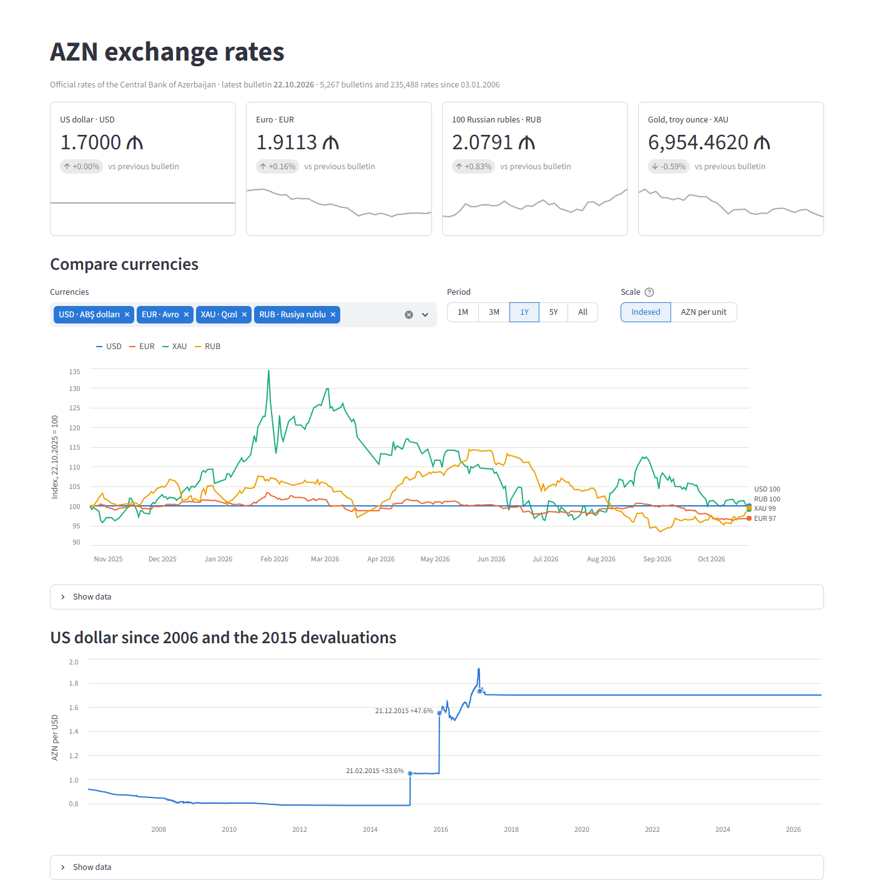

# CBAR AZN Exchange Rates — ETL Pipeline

An end-to-end data engineering project. It **extracts** the official daily exchange rates of the
Azerbaijani manat (AZN) from the Central Bank of the Republic of Azerbaijan (CBAR), **transforms** and
validates them with Python, **loads** them into PostgreSQL, and serves **SQL analytics** and a
**dashboard** on top. Everything is reproducible with `docker compose up`.

> Course: *Practicum: Data Engineering with Python (Git, Docker, SQL)*, AzTU, Master's program
> Status: ✅ complete (`v1.0.0`), see [Roadmap](#roadmap)



---

## Table of contents

1. [Architecture](#architecture)
2. [Tech stack](#tech-stack)
3. [Data source: CBAR API](#data-source-cbar-api)
4. [Data model](#data-model)
5. [Pipeline logic](#pipeline-logic)
6. [Design decisions](#design-decisions)
7. [Project structure](#project-structure)
8. [Getting started](#getting-started)
9. [Usage](#usage)
10. [SQL analytics](#sql-analytics)
11. [Results](#results)
12. [Dashboard](#dashboard)
13. [Testing](#testing)
14. [Git workflow](#git-workflow)
15. [Roadmap](#roadmap)

---

## Architecture

```text
             ┌───────────────────────────── docker compose ─────────────────────────────┐
             │                                                                          │
 cbar.az ────┼─► Extract ──► Transform ──► Load ─────────► PostgreSQL 17 ◄── SQL views  │
 daily XML   │   requests    XML parsing   psycopg 3        (named volume)       │       │
             │   retry       validation    batch UPSERT          ▲               ▼       │
             │   backoff     de-dup        run log               │        Streamlit      │
             │                                                   │        dashboard      │
             │   etl service (one-shot job)                      │        :8501          │
             └───────────────────────────────────────────────────┴──────────────────────┘
```

Every run is recorded in the `etl_runs` table. The pipeline is **idempotent**: a second run over the
same dates writes nothing.

## Tech stack

| Area            | Tools                                                        |
|-----------------|--------------------------------------------------------------|
| Language        | Python 3.12                                                  |
| Extract         | `requests`: session, timeout, retry with exponential backoff |
| Transform       | `xml.etree.ElementTree`, `decimal.Decimal`, dataclasses      |
| Load            | `psycopg` 3, PostgreSQL 17                                   |
| Containers      | Docker, Docker Compose                                       |
| Quality         | `pytest` (unit and integration), `ruff`, GitHub Actions      |
| Dashboard       | Streamlit, Altair, pandas                                    |
| Version control | Git: feature branches, Conventional Commits, release tags    |

---

## Data source: CBAR API

### Endpoint

```text
GET https://www.cbar.az/currencies/{DD.MM.YYYY}.xml
```

No API key, no authentication, no registration.

### Response example (trimmed)

```xml
<ValCurs Date="21.10.2026" Name="AZN məzənnələri" Description="...">
  <ValType Type="Bank metalları">
    <Valute Code="XAU">
      <Nominal>1 t.u.</Nominal>
      <Name>Qızıl</Name>
      <Value>6995.4575</Value>
    </Valute>
  </ValType>
  <ValType Type="Xarici valyutalar">
    <Valute Code="USD">
      <Nominal>1</Nominal>
      <Name>1 ABŞ dolları</Name>
      <Value>1.7</Value>
    </Valute>
    <Valute Code="RUB">
      <Nominal>100</Nominal>
      <Name>100 Rusiya rublu</Name>
      <Value>2.0619</Value>
    </Valute>
  </ValType>
</ValCurs>
```

`Value` is the price of `Nominal` units in AZN, so 1 RUB = 2.0619 / 100 AZN.

### API behaviour verified before development

The endpoint was probed on **2026-10-22** with [`scripts/probe_cbar_api.py`](scripts/probe_cbar_api.py).
Each finding below shaped the pipeline:

| # | Finding | Evidence | How the pipeline handles it |
| --- | --- | --- | --- |
| 1 | **Weekends, holidays and future dates return the *last published* bulletin** instead of an error | Request `18.10.2026` (Sun) → `ValCurs Date="16.10.2026"` (Fri). Request `21.11.2026` → latest bulletin | The authoritative date is the **`ValCurs/@Date` attribute**, never the requested date. Bulletins are de-duplicated by that date |
| 2 | **Invalid requests still return HTTP 200**, with an HTML page as the body | `31.02.2026`, `2026-10-21`, `abc`, `15.06.1990` → `200 text/html`, 141 KB | The response must have an XML `Content-Type` **and** a `ValCurs` root, otherwise `InvalidResponseError` |
| 3 | **Three kinds of `Nominal`**: `1`, `100` (JPY, RUB, KZT, KRW, HUF, UZS, PKR) and `1 t.u.` (troy ounce, bank metals). Historical files also contain `10000` | Today: 31 × `1`, 7 × `100`, 4 × `1 t.u.` | The leading integer is stored as `nominal`, and `rate_per_unit = value / nominal`. Metals get unit `troy_ounce` |
| 4 | **Two categories** under `ValType`: `Xarici valyutalar` (38 currencies) and `Bank metalları` (4 metals: XAU, XAG, XPT, XPD) | 42 rows per bulletin | Stored as `category` = `currency` / `metal`. An unknown section rejects the bulletin |
| 5 | **Empty `Value`** in old bulletins (metals in 2000, 2005 and early 2006) | `<Value></Value>` for XPD on 09.03.2005 | The row is skipped and counted in `rows_skipped` |
| 6 | **Manat denomination (2006): pre-2006 values are in old manat** (1 new AZN = 5000 old AZM) | USD `4593` on 30.12.2005 vs `0.8963` on 15.06.2006. Request `03.01.2006` still returns the `30.12.2005` bulletin | Bulletins with `ValCurs/@Date < 2006-01-01` are rejected. The check uses the **bulletin date**, not the requested date |
| 7 | **The currency list changes over time** | Since 2010, ARS, BRL, EGP, IDR, IRR, LBP, MXN, TJS and ZAR were removed, and CZK, HUF, PKR, QAR, RON and RSD were added | The `currencies` dimension is upserted dynamically, with `first_seen` / `last_seen` |
| 8 | **Data availability**: from 1994. Usable range for this project: **2006 → today** | 1992–1993 → HTML. 1994 → 21 rows | The CLI rejects `--from` earlier than 2006-01-01 |
| 9 | **No rate limiting observed**: 30 sequential requests gave 30 × HTTP 200 in ~3.5 s. `Cache-Control: no-store` | Burst test | A polite 0.2 s delay between requests, a 15 s timeout and 3 retries with exponential backoff (network errors and 5xx only) |
| 10 | Encoding is UTF-8 with Azerbaijani characters (`ə`, `ü`, `ş`) | `Name="AZN məzənnələri"` | The XML parser reads raw bytes (`response.content`), not `response.text` |

---

## Data model

```text
┌──────────────────────────┐        ┌──────────────────────────────────┐
│ currencies               │        │ exchange_rates                   │
├──────────────────────────┤        ├──────────────────────────────────┤
│ code        CHAR(3)  PK  │◄───────│ currency_code CHAR(3)   PK, FK   │
│ name_az     TEXT         │        │ rate_date     DATE      PK       │
│ category    TEXT         │        │ nominal       INTEGER            │
│ unit        TEXT         │        │ value         NUMERIC(18,6)      │
│ first_seen  DATE         │        │ rate_per_unit NUMERIC(20,10)     │
│ last_seen   DATE         │        │               GENERATED STORED   │
└──────────────────────────┘        │ loaded_at     TIMESTAMPTZ        │
                                    └──────────────────────────────────┘
┌──────────────────────────────────────────┐
│ currency_redenominations   (reference)   │
├──────────────────────────────────────────┤
│ currency_code PK, effective_date,        │
│ factor, note    -- BYN 2016, TMT 2009    │
└──────────────────────────────────────────┘
┌──────────────────────────────────────────────────────────┐
│ etl_runs                                                 │
├──────────────────────────────────────────────────────────┤
│ run_id, status (running | success | partial | failed),   │
│ started_at, finished_at, date_from, date_to,             │
│ days_requested, days_failed, bulletins_loaded,           │
│ duplicates, rejected, rows_inserted, rows_updated,       │
│ rows_unchanged, rows_skipped, error_message              │
└──────────────────────────────────────────────────────────┘
```

- `CHECK` constraints guard codes (`^[A-Z]{3}$`), categories, units, positive values and the
  2006 lower bound for `rate_date`
- The primary key `(currency_code, rate_date)` serves per-currency time series. A second index on
  `rate_date` serves per-day lookups

DDL: [`sql/01_schema.sql`](sql/01_schema.sql)

---

## Pipeline logic

```text
apply sql/01_schema.sql and sql/02_views.sql           (idempotent DDL)
INSERT etl_runs (status = running)                     (committed at once)

BEGIN
  for each calendar day in [date_from, date_to]:
      GET /currencies/{day}.xml                        retry ×3 on network errors / 5xx
      require XML with a <ValCurs> root                finding #2, else the day is logged as failed
      bulletin_date = ValCurs/@Date                    finding #1
      skip if bulletin_date already seen in this run   weekends / holidays
      reject if bulletin_date < 2006-01-01             finding #6
      parse rows; skip empty or invalid values         findings #3, #4, #5
  every 100 bulletins:
      UPSERT currencies       (first_seen = LEAST, last_seen = GREATEST)
      UPSERT exchange_rates   (rewrite only rows whose values changed)
COMMIT                                                 or ROLLBACK on any error

UPDATE etl_runs: status, counters, error_message
```

Run status: `success`, or `partial` when some days failed to download (the rest is still loaded), or
`failed` when an exception rolled the whole batch back. The process exit code is 0 / 1 / 2.

---

## Design decisions

| Decision | Why |
| --- | --- |
| `Decimal` in Python, `NUMERIC` in SQL | Binary floats cannot represent `1.7` exactly. Money-like values must not drift |
| Bulletin date from `ValCurs/@Date` | The requested date is wrong for weekends and holidays (finding #1) |
| `INSERT … SELECT FROM unnest(arrays)` | One round trip per batch of ~4,200 rows instead of 4,200 statements |
| `ON CONFLICT … DO UPDATE … WHERE … IS DISTINCT FROM` | A re-run does not touch unchanged rows, so `loaded_at` keeps its meaning and the run log can count *inserted / updated / unchanged* (`RETURNING xmax = 0`) |
| One transaction per run, run log outside it | Data is all-or-nothing, but failed runs remain visible in `etl_runs` |
| Generated column `rate_per_unit` | Prices quoted per 100 units (RUB, JPY, …) become directly comparable, and the formula exists in one place only |
| Schema and views applied on every run | No separate migration step. All DDL is `IF NOT EXISTS` / `CREATE OR REPLACE` |
| `RANGE BETWEEN INTERVAL '6 days' PRECEDING` | A "7-day" average really covers 7 calendar days, even across weekends and holidays |
| `TZ=Asia/Baku` in containers | CBAR publishes by Baku time. In UTC, "today" is wrong between 00:00 and 04:00 |
| Non-root containers, slim base image | Smaller attack surface |

Known limitation: two runs at the same time are serialized. `CREATE INDEX IF NOT EXISTS` waits for
the other run's open transaction, so the second run starts when the first one commits.

---

## Project structure

```text
.
├── README.md
├── docker-compose.yml          # postgres + etl (one-shot) + dashboard
├── Dockerfile                  # ETL image
├── .dockerignore
├── .env.example                # copy to .env
├── .gitignore
├── .gitattributes              # LF line endings (Windows ↔ Linux containers)
├── pyproject.toml              # ruff + pytest configuration
├── requirements.txt            # ETL runtime
├── requirements-dev.txt        # pytest, ruff
├── .github/workflows/ci.yml    # lint, tests with PostgreSQL, image builds
├── .streamlit/config.toml      # dashboard theme
├── etl/
│   ├── config.py               # settings from environment variables
│   ├── extract.py              # HTTP client: retry, backoff, response validation
│   ├── transform.py            # XML → validated, de-duplicated records
│   ├── load.py                 # schema, batch upserts, run log
│   └── main.py                 # CLI and pipeline orchestration
├── sql/
│   ├── 01_schema.sql           # tables, constraints, indexes
│   ├── 02_views.sql            # analytical views
│   └── 03_analysis.sql         # report queries (run manually)
├── dashboard/
│   ├── app.py                  # Streamlit app
│   ├── Dockerfile
│   └── requirements.txt
├── scripts/
│   └── probe_cbar_api.py       # API behaviour probe (see findings table)
├── tests/
│   ├── fixtures/               # real CBAR XML bulletins
│   ├── test_extract.py         # unit: HTTP, retries, validation
│   ├── test_transform.py       # unit: parsing and data rules
│   ├── test_main.py            # unit: CLI arguments
│   └── test_load.py            # integration: PostgreSQL, views, full pipeline
└── docs/
    └── dashboard.png
```

---

## Getting started

### Prerequisites

- Docker Desktop (Compose v2.24+)
- Git
- *(local development only)* Python 3.12+

### Run everything with Docker

```bash
git clone https://github.com/<your-username>/cbar-etl.git
cd cbar-etl
cp .env.example .env                        # optional: defaults work out of the box
docker compose up -d --build                # postgres + dashboard; etl loads the last 30 days
docker compose run --rm etl --from 2006-01-01   # optional: full history (~40 min, ~235k rows)
```

Then open the dashboard at **<http://localhost:8501>**.

### Local development

```bash
python -m venv .venv
source .venv/bin/activate                   # Windows: .venv\Scripts\activate
pip install -r requirements.txt -r requirements-dev.txt
docker compose up -d postgres
python -m etl.main --days 30
pytest -v
```

### Environment variables

| Variable            | Default                          | Description                                    |
|---------------------|----------------------------------|------------------------------------------------|
| `POSTGRES_USER`     | `etl`                            | Database user                                  |
| `POSTGRES_PASSWORD` | `etl`                            | Database password                              |
| `POSTGRES_DB`       | `cbar`                           | Database name                                  |
| `POSTGRES_HOST`     | `localhost`                      | Compose sets it to `postgres` inside containers |
| `POSTGRES_PORT`     | `5432`                           | Database port (also the published host port)   |
| `DASHBOARD_PORT`    | `8501`                           | Published dashboard port                       |
| `CBAR_BASE_URL`     | `https://www.cbar.az/currencies` | API base URL                                   |
| `REQUEST_TIMEOUT`   | `15`                             | Seconds per HTTP request                       |
| `REQUEST_DELAY`     | `0.2`                            | Seconds between requests                       |
| `MAX_RETRIES`       | `3`                              | Retries on network errors and 5xx              |
| `RETRY_BACKOFF`     | `1.0`                            | First backoff in seconds (doubles each retry)  |
| `LOG_LEVEL`         | `INFO`                           | Python logging level                           |

---

## Usage

```bash
python -m etl.main                          # last 30 days
python -m etl.main --days 90                # last 90 days
python -m etl.main --from 2015-01-01 --to 2015-12-31
docker compose run --rm etl --from 2024-01-01   # the same, inside Docker
```

Example: the first run, then the same command again.

```text
INFO    etl.main     Run #1 started
INFO    etl.extract  Requesting 30 days: 2026-09-23 -> 2026-10-22
INFO    etl.load     Loaded 22 bulletins up to 2026-10-22
INFO    etl.main     Downloaded 30/30 days
INFO    etl.main     22 unique bulletins, 8 duplicates (weekends/holidays), 0 rejected, 0 rows skipped
INFO    etl.main     Rows: 924 inserted, 0 updated, 0 unchanged
INFO    etl.main     Run #1 finished: success (10.3s)
...
INFO    etl.main     Rows: 0 inserted, 0 updated, 924 unchanged
INFO    etl.main     Run #2 finished: success (10.4s)
```

Open a SQL shell:

```bash
docker compose exec postgres psql -U etl -d cbar
```

---

## SQL analytics

Views in [`sql/02_views.sql`](sql/02_views.sql), re-created on every run:

```text
exchange_rates (raw, as published)
   └─► v_rate_checks    redenomination-adjusted rate + spike detection (LAG/LEAD 3 and 10)
         ├─► v_clean_rates    suspect rows removed; all analytical views read from here
         └─► v_suspect_rates  the removed rows, for data-quality review
```

| View                  | Technique                                          | Question it answers                                    |
|-----------------------|----------------------------------------------------|--------------------------------------------------------|
| `v_rate_checks`       | `LAG/LEAD(x, k)`, `LEFT JOIN` reference table      | Is this rate an isolated spike? What is it in today's units? |
| `v_daily_change`      | `LAG()` over a named `WINDOW`                      | How much did each currency move since the previous bulletin? |
| `v_latest_rates`      | view on a view, scalar subquery                    | What are the current official rates?                   |
| `v_moving_averages`   | `AVG() OVER (RANGE BETWEEN INTERVAL … PRECEDING)`  | 7-day and 30-day calendar trends                       |
| `v_monthly_summary`   | `ARRAY_AGG(… ORDER BY …)[1]`, `GROUP BY`           | Monthly open / high / low / close                      |
| `v_yearly_volatility` | `STDDEV_SAMP`, `RANK() OVER (PARTITION BY year)`   | Which currency was the most volatile each year?        |
| `v_shocks`            | filter on window results                           | Days with a move of 5 % or more                        |
| `v_usd_cross_rates`   | self-join                                          | Prices in USD, e.g. EUR/USD or gold per ounce          |
| `v_etl_runs`          | interval arithmetic                                | Pipeline monitoring                                    |

Report queries in [`sql/03_analysis.sql`](sql/03_analysis.sql) (CTEs, `FILTER`, `DISTINCT ON`,
`HAVING`, window functions on aggregates):

```bash
docker compose exec -T postgres psql -U etl -d cbar < sql/03_analysis.sql
```

---

## Results

Full backfill **2006-01-01 → 2026-10-22**: 7,600 days requested in one run (42 min, status
`success`).

| Metric | Value |
| --- | --- |
| Rates loaded | **235,488** rows, 23 MB |
| Bulletins | 5,267 unique (2,330 weekend/holiday repeats skipped) |
| Currencies and metals | 55 codes over time (42 published today) |
| Rejected | 3 old-manat bulletins (1–3 Jan 2006), 94 rows with empty values |

### What the data shows

- **The manat's three regimes.** From 2006 to 2014 the manat appreciated slowly
  (USD 0.89 → 0.78 AZN). In **2015** it was devalued twice: **+33.6 %** on 21.02.2015 (0.7862 → 1.0500)
  and **+47.6 %** on 21.12.2015 (1.0499 → 1.5500), so the dollar ended the year **+98.8 %** higher.
  After a floating period (1.49–1.92 in 2016–2017), the rate has stayed at **1.7000 (±0.0001) since
  24.11.2017**
- **Gold.** 550.72 AZN per troy ounce at the end of 2006, and 7,419.31 at the end of 2025 (×13.5).
  In USD the rise is only ×6.9 (632 → 4,364): the other half is the manat's devaluation
- **2026 year to date.** KZT is the strongest (+13.0 % against AZN), TRY the weakest
  currency (−13.2 %). Precious metals are falling sharply: palladium −36.6 %, platinum −27.3 %,
  silver −25.4 %, gold −7.1 %
- **Volatility over the last 365 days.** RUB is the most volatile (σ of daily change 0.87 %),
  followed by HUF (0.74 %) and BYN (0.66 %). USD is at 0 because of the peg
- **EUR/USD derived through AZN** matches the market history: the yearly average peaked at
  1.4710 in 2008 and bottomed at 1.0521 in 2022

### Data quality findings

Loading 20 years of history found problems that a 30-day sample never shows:

| Finding | Scale | Handling |
| --- | --- | --- |
| **Isolated errors in CBAR's archive.** On 04.07.2007, 20 currencies carry their neighbour's value (e.g. KZT 0.5132 = GEL's rate). DKK = 1567 instead of 0.1567 on 14.08.2015. XAG, XPD and XPT are swapped on 5 days in April 2009 | 86 rows, 30 currencies, 46 bulletins (0.037 %) | Raw data is kept as published. `v_rate_checks` flags them, analytics reads `v_clean_rates`, and the rows can be reviewed in `v_suspect_rates` |
| **Redenominations under an unchanged code.** BYN on 01.07.2016 (10,000:1) and TMT on 13.01.2009 (5,000:1) | Without handling: day-over-day moves of +996,523 % and +248,927 % | `currency_redenominations` reference table. The real moves are −0.34 % and +0.50 % |
| **Quoting nominal changed** for RUB, KZT, BYN, TMT and IRR (e.g. RUB per 1 → per 100 on 18.11.2024) | 5 currencies | `rate_per_unit = value / nominal` makes the series continuous |
| **13 currencies were discontinued** (11 of them on 16.11.2024: ARS, BRL, MXN, …) | 13 currencies | `currencies.last_seen` |
| **Gaps of 10–13 days** every March | Novruz holidays | Expected. The views compare bulletins, not calendar days |

Large moves that remain in `v_shocks` are mostly genuine: Lebanon's official-rate change (LBP −90 %,
02.02.2023), Argentina's devaluation (ARS −54 %, 14.12.2023) and the 2015 AZN devaluations. A few
long-lasting jumps (e.g. KGS in October 2010) look like source errors as well. They last longer
than the 10-bulletin detection window, so the pipeline cannot tell them apart from a real level
change, and they are deliberately not removed.

---

## Dashboard

`docker compose up -d dashboard` → <http://localhost:8501>

- **Headline tiles**: USD, EUR, 100 RUB and gold, with the change since the previous bulletin and a
  45-day sparkline
- **Compare currencies**: up to 8 currencies. *Indexed* mode puts all of them on one axis
  (start = 100). *AZN per unit* mode shows real prices as small multiples, one chart per currency,
  so no chart needs two y-axes
- **USD since 2006**: the full history with the 2015 devaluations marked
- **Volatility ranking** of the last 365 days, the **full rates table** and the **pipeline run log**

Each chart has a hover tooltip and a "Show data" table. Each currency keeps a fixed color, and
the palette was checked for color-vision deficiency in both light and dark themes.

---

## Testing

```bash
pytest -v          # 75 tests
ruff check .
```

| Suite               | Kind        | Covers                                                                    |
|---------------------|-------------|---------------------------------------------------------------------------|
| `test_extract.py`   | unit        | URL format, HTML-with-200 rejection, retry/backoff timing, 4xx without retry, range iteration |
| `test_transform.py` | unit        | real bulletins (42 rows), nominals, `Decimal` precision, empty values, old manat, de-duplication |
| `test_main.py`      | unit        | CLI defaults and every invalid argument combination                       |
| `test_load.py`      | integration | idempotent reload, updates, rollback, run log, every view, redenominations, spike detection vs. genuine level shifts, full pipeline with a fake CBAR server |

Unit tests never touch the network. Integration tests run against a real PostgreSQL, each in its
own throw-away schema. Without a database they are skipped locally, but in CI `REQUIRE_DB=1` turns
a missing database into a failure.

---

## Git workflow

- `main` always works. Every phase was built on its own branch and merged with `--no-ff`, so
  `git log --graph` shows the history phase by phase:
  `feature/extract`, `feature/transform`, `feature/load`, `feature/docker`,
  `feature/sql-analytics`, `feature/dashboard`, `feature/ci`, `fix/dashboard-polish`,
  `fix/redenominations`, `fix/dashboard-theme`, `docs/final-readme`
- Commit messages follow [Conventional Commits](https://www.conventionalcommits.org/):
  `feat:`, `fix:`, `ci:`, `docs:`, `chore:`
- Release tags: `v0.1.0` (extract), `v0.5.0` (database load), `v1.0.0` (final)
- Secrets (`.env`) are never committed. `.env.example` documents them

```bash
git log --graph --oneline --all
```

---

## Roadmap

- [x] **Phase 1, API research.** Endpoint probing, edge cases, findings table
- [x] **Phase 0, Setup.** Git repo, `.gitignore`, `.env.example`, `requirements.txt`, virtualenv
- [x] **Phase 2, Extract.** HTTP session, timeout, retry/backoff, response validation, logging, CLI
- [x] **Phase 3, Transform.** XML parsing, nominal normalization, de-duplication, denomination guard, unit tests
- [x] **Phase 4, Load.** Schema, batch upserts, transactions, `etl_runs` log, idempotency, integration tests
- [x] **Phase 5, Docker.** `Dockerfile`, `docker-compose.yml`, healthcheck, named volume, timezone
- [x] **Phase 6, SQL analytics.** Views, report queries, historical backfill 2006 → today, data-quality layer
- [x] **Phase 7, Dashboard.** Streamlit + Altair on top of the views
- [x] **Phase 8, Polish.** GitHub Actions CI, final README, screenshot, `v1.0.0` tag

Possible next steps: daily scheduling (cron or Airflow), incremental runs that start from the last
loaded date, and alerting on `failed` runs.

---

## License

Educational project. Exchange rate data © Central Bank of the Republic of Azerbaijan ([cbar.az](https://www.cbar.az)).
